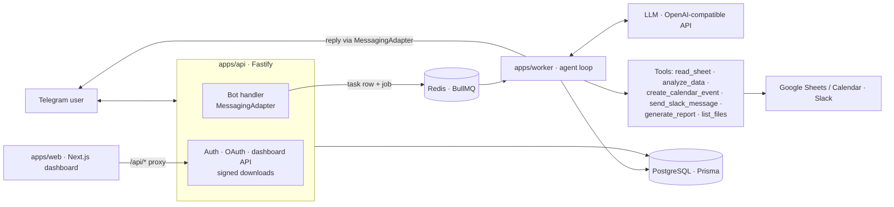

# AI Business Assistant

Control business tools by chatting with a Telegram bot. Send an instruction like
*"Analyze my sales sheet and post the summary to #sales"*. The system creates a task,
an AI agent plans and runs it with tools (Google Sheets, Google Calendar, Slack,
file analysis, PDF reports) and the bot replies with results and secure links.
A web dashboard shows integrations, task history and every step taken.

## Architecture



How a message flows:

1. The bot receives a message (duplicate `update_id`s are ignored) and creates a `tasks` row with status `queued`, enqueues a job, and acknowledges immediately.
2. The worker moves the task to `running` and runs the agent: at most 8 model turns at temperature 0.1.
3. Every tool call is validated with Zod and recorded as a `task_steps` row (input, output or error, timestamps, external IDs). Invalid arguments are returned to the model so it can correct itself.
4. External actions (Slack posts, calendar invites to other people) pause the task in `awaiting_confirmation` and the bot asks with ✅ / ❌ buttons. On approval the agent resumes from its saved state.
5. The task ends as `completed` (the bot replies with the result and any links) or `failed`.

Key rules:

- **The model never does math.** `apps/worker/src/analysis.ts` computes totals, averages, growth, profit/loss and group totals. The model only gets compact summaries (columns, row count, stats, 5 sample rows), never whole files.
- **Slack allowlist.** `send_slack_message` refuses channels that aren't approved in the dashboard, records a `rejected` step, and tells the user.
- **No duplicate actions.** Each tool call has an idempotency key `(task_id, step_index, tool)`. A completed step is never re-run. The agent state is saved after every step, so retries resume exactly where they stopped.
- **Retries.** BullMQ retries transient errors (network, 429, 5xx) with exponential backoff. The Slack client waits out `ratelimited` responses using `Retry-After`. Validation and permission errors are not retried.
- **Security.** Passwords are hashed with argon2 and sessions use httpOnly cookies. "Reset password using Telegram" sends a single-use, 15-minute reset link to the user's linked Telegram chat (only its hash is stored); a reset logs out all sessions. OAuth tokens are encrypted with AES-256-GCM. Download links are HMAC-signed and expire after 24h by default; anything else gets 403. Tokens and query strings are never logged.

## Project layout

```
apps/api       Fastify server: auth, OAuth callbacks, dashboard API, downloads, Telegram bot handler
apps/worker    BullMQ worker: agent loop, tools, analysis, PDF/chart reports
apps/web       Next.js + Tailwind dashboard
packages/shared  env, Prisma schema + client, crypto, signed URLs, task states, queue, messaging adapters
```

## Setup

Requirements: Node 20+, pnpm 10, Docker.

```bash
pnpm install
cp .env.example .env          # then fill it in (see below)
docker compose up -d          # Postgres + Redis
pnpm db:migrate               # creates the tables
pnpm dev                      # web :3000, api :4000, worker
```

Open http://localhost:3000, create an account, then connect your integrations.

### External accounts

**Telegram:** message [@BotFather](https://t.me/BotFather), run `/newbot`, and copy the token into `TELEGRAM_BOT_TOKEN` and the bot's username (without `@`) into `TELEGRAM_BOT_USERNAME`. In dev the bot uses long polling, so no webhook is needed.

**Google:** in Google Cloud Console, create a project and enable the **Google Sheets API** and **Google Calendar API**. Configure the OAuth consent screen and add yourself as a test user. Then create an OAuth client of type *Web application* with redirect URI `http://localhost:3000/api/oauth/google/callback`. Scopes requested: `spreadsheets.readonly`, `calendar.events`.

**Slack:** create an app at https://api.slack.com/apps. Under *OAuth & Permissions*, add bot scopes `chat:write`, `chat:write.public`, `channels:read`, `channels:join`, `files:write` (the last two let the bot share report files) and the redirect URL `<APP_URL>/api/oauth/slack/callback`. Slack requires HTTPS, so for local dev expose port 3000 with a tunnel (e.g. `ngrok http 3000`) and set `APP_URL` to the tunnel URL.

**LLM:** any OpenAI-compatible endpoint. Defaults to Ollama Cloud (`https://ollama.com/v1`) with model `gpt-oss:120b`; put your Ollama API key in `OPENAI_API_KEY`. For local Ollama, use `OPENAI_BASE_URL=http://localhost:11434/v1` and e.g. `LLM_MODEL=qwen3:8b`.

### Environment variables

| Variable | Description |
|---|---|
| `DATABASE_URL` | Postgres connection string (docker compose default works) |
| `REDIS_URL` | Redis connection string |
| `APP_URL` | Public dashboard URL; used for OAuth redirects and download links |
| `API_URL` | Where the dashboard proxies `/api/*` (default `http://localhost:4000`) |
| `API_PORT` | API port (default 4000) |
| `ENCRYPTION_KEY` | 32 bytes, base64. Encrypts OAuth tokens (`openssl rand -base64 32`) |
| `SIGNING_SECRET` | HMAC secret for download links and OAuth state |
| `OPENAI_BASE_URL` | LLM endpoint (OpenAI-compatible) |
| `OPENAI_API_KEY` | LLM API key (Ollama Cloud key) |
| `LLM_MODEL` | Model name, e.g. `gpt-oss:120b` |
| `TELEGRAM_BOT_TOKEN` | Bot token from BotFather |
| `TELEGRAM_BOT_USERNAME` | Bot username, used for the account-link URL |
| `GOOGLE_CLIENT_ID` / `GOOGLE_CLIENT_SECRET` | Google OAuth client |
| `SLACK_CLIENT_ID` / `SLACK_CLIENT_SECRET` | Slack app credentials |
| `STORAGE_DIR` | Local directory for uploads and reports (default `./storage`) |
| `DOWNLOAD_LINK_TTL_HOURS` | Download link lifetime (default 24) |
| `TIMEZONE` | Default timezone for calendar events (IANA name) |

## Commands

| Command | |
|---|---|
| `docker compose up -d` | Start Postgres + Redis |
| `pnpm dev` | Run web, api and worker |
| `pnpm test` | Unit tests (Vitest); no database or network needed |
| `pnpm typecheck` | TypeScript check of all packages |
| `pnpm db:migrate` | Prisma migrations |

Tests cover tool permission checks, idempotency, signed URLs, task state transitions, token encryption, the agent loop/confirmation flow and the data analysis calculations.

## Demo script

1. **Sign up** at http://localhost:3000 (name, email, password), then **create your agent**: pick an avatar, a name (e.g. "Riya") and a personality. The agent replies with that name and tone, in the user's language.
2. **Link Telegram:** click *Link Telegram*, open the link within 10 minutes, press *Start*. The bot replies "Linked!".
3. **Connect Google** and **Connect Slack** on the same page. Tick `#sales` under approved Slack channels.
4. **File → PDF report:** send the bot a CSV or XLSX (e.g. columns `Month, Region, Revenue, Cost`). It replies with a summary and a `📄 Report:` link to a PDF with a chart. Change the link's `sig` and you get 403.
5. **Google Sheets:** under *Saved sheets* in the dashboard, save a sheet link as `sales` (the first saved sheet becomes the ★ default). Then send *"Summarize revenue by region in my sales sheet"*, or just *"Analyze my sheet"* for the default. A sheet link pasted in chat also works.
6. **Calendar:** *"Schedule a 30 min sync tomorrow at 3pm with alice@example.com"*. Press ✅ Confirm, and the bot returns the event and Google Meet links.
7. **Slack, approved:** *"Post 'Sales are up 12% this month' to #sales"*, then ✅ Confirm. The message appears in Slack.
8. **Slack, refused:** *"Post hello to #general"*. The bot replies that `#general` is not approved; nothing is posted.
9. **Audit log:** open *Tasks* in the dashboard. Each task shows its status and a step timeline with inputs, outputs, errors and external IDs (Slack `ts`, Calendar event ID).
